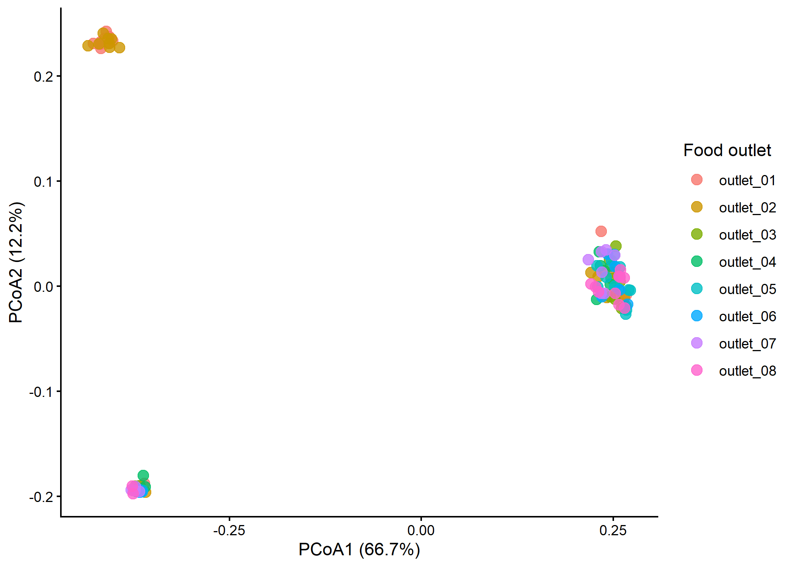
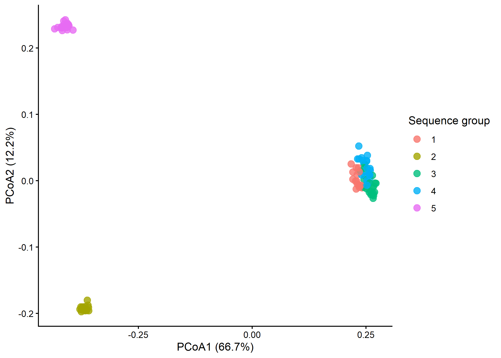

<h1 align="center">🥩 Bristol Bacteria Meat Mystery 🦠</h1>
<p align="center"><i>Identifying the pathogen behind a simulated food-poisoning outbreak</i></p>

Bioinformatic investigation of 100 bacterial DNA sequences isolated from meat
samples at 8 food outlets (simulated outbreak exercise). This repository
contains all code needed to reproduce the analysis in the accompanying report.

---


## Repository structure

```
data/                          raw FASTA files, one folder per outlet (never modified)
  outlet_01/ ... outlet_08/
scripts/
  01_prepare_data.sh           Step 1: combine and label sequences (Bash)
  02_align_clustalo.sh         Step 2a: Slurm job - align sequences with Clustal Omega (Blue Pebble HPC)
  03_sequence_groups.R         Steps 2b-3: distances, PCoA, clustering, representatives (R)
combined/                      copies of each FASTA file with the outlet added to the header
all_sequences.fasta            all 100 labelled sequences in one multi-FASTA file (unaligned)
results/
  all_sequences_aligned.fasta  Clustal Omega alignment of all 100 sequences
  slurm-20382747.out           log from the Blue Pebble alignment job
  silhouette_widths.csv        mean silhouette width for each k
  groups_by_outlet.csv         number of sequences from each group at each outlet
  sequence_groups.csv          group assigned to every sequence
  representatives.fasta        one representative sequence per group (ungapped)
  sessionInfo_R.txt            R and package versions
figures/
  fig1_pcoa_by_outlet.png      PCoA coloured by food outlet
  fig2_pcoa_by_group.png       PCoA coloured by inferred sequence group
  silhouette_widths.png        mean silhouette width against k
```

---

## Software and dependencies

| Step | Software | Version | Where it was run |
|---|---|---|---|
| 1 | Bash, `sed`, `cat` | [bash --version] | GitHub Codespaces (Ubuntu Linux) |
| 2a | Git Bash (`ssh`, `scp`) | [ ] | Local Windows PC |
| 2a | Slurm job scheduler | - | Blue Pebble HPC, University of Bristol |
| 2a | Clustal Omega | 1.2.4 (module `clustal-omega/1.2.4-skoy`) | Blue Pebble HPC |
| 2b-3 | R | [R.version.string] | RStudio on a local Windows PC |
| 2b-3 | ape | [see results/sessionInfo_R.txt] | |
| 2b-3 | cluster | [ ] | |
| 2b-3 | ggplot2 | [ ] | |
| 2b-3 | here | [ ] | |

Exact R package versions are saved automatically to `results/sessionInfo_R.txt`
when `03_sequence_groups.R` is run.

---

## How to reproduce the analysis

All commands are run from the repository root. Outputs of every step, including
the manual ones, are included in the repository, so any step can be skipped to
reproduce the steps that follow it.

**Setup: clone the repository and install Python packages**
```bash
git clone https://github.com/dylanphillips076-sketch/Bristol-Bacteria-Meat-Mystery.git
cd Bristol-Bacteria-Meat-Mystery
pip install -r requirements.txt
```

**Step 1: combine and label the sequences** (Bash)
```bash
bash scripts/01_prepare_data.sh
grep -c ">" all_sequences.fasta   # should return 100
```

**Step 2a: align the sequences** (Blue Pebble HPC, *manual*)
See [Step 2a](#step-2a-multiple-sequence-alignment-clustal-omega-on-blue-pebble)
for the commands. Output: `results/all_sequences_aligned.fasta`.

**Steps 2b–3: sequence groups and representatives** (R)
Open `Bristol-Bacteria-Meat-Mystery.Rproj` in RStudio and run
`scripts/03_sequence_groups.R` from top to bottom (missing packages are installed
automatically). Output: `figures/`, `results/representatives.fasta`.

**Step 4: ORF prediction and translation** (Python)
```bash
python scripts/04_orf_prediction.py
```
Output: `results/representative_proteins.fasta`.

**Step 5: BLASTP and reference selection**
Run BLASTP on the NCBI website (*manual*; see
[Step 5](#step-5-blastp-searches-and-reference-selection) for the settings) and
save the results as `results/blast/all_queries_blastp.xml`. Then process them:
```bash
python scripts/05_blastp.py
```
References are chosen from `results/blast/reference_candidates.csv` (*manual*)
and recorded in `results/selected_references.csv`.

**Step 6: alignment of proteins and references:** [To be added]

**Step 7: phylogenetic tree:** [To be added]


## Code adaptation

Code in this repository adapts and extends material from the practical classes
of **Introduction to Bioinformatics** (BIOLM0052, TB1), MSc Bioinformatics,
University of Bristol, 2026/27. Specific practicals are named in each step below.

---

## Step 1: Data preparation (Bash)

**Script:** `scripts/01_prepare_data.sh`

**What it does**

1. Creates a folder `combined/`.
2. Loops over each outlet folder in `data/` (`outlet_01` to `outlet_08`).
3. For every FASTA file in that folder, uses `sed "s/^>/>${outlet}_/"` to add the
   outlet name to the start of the sequence header
   (e.g. `>seq014` becomes `>outlet_03_seq014`), and writes the edited copy to
   `combined/<outlet>_<filename>`.
4. Concatenates all labelled files into a single multi-FASTA file,
   `all_sequences.fasta` (100 sequences).

**Rationale**

- In the raw data the outlet is recorded only by the folder a file sits in. Once
  sequences are loaded into other software that information would be lost, so the
  outlet is written into each header and stays with the sequence through every
  later step (outlet colours in Figure 1, tip labels in the tree).
- The raw files in `data/` are never edited; all changes are written to new files.
  This keeps the original data intact and means the step can be rerun from scratch.
- The outlet is also added to each file name so files with the same name in
  different outlets cannot overwrite each other.
- A single multi-FASTA file is the standard input for alignment and BLAST.

**Manual step**

- The eight `outlet_` folders were uploaded into `data/` by hand (drag and drop into
  the Codespace), keeping the folder structure so the outlet information was
  preserved. A macOS system file (`.DS_Store`) in the original download was not
  included.

---

## Step 2a: Multiple sequence alignment (Clustal Omega on Blue Pebble)


**Why an alignment was needed:** the sequences varied in length (3,126–3,615 bp),
so positions could not be compared directly. Pairwise distances require
homologous positions to be lined up in the same column, so all 100 sequences
were aligned first.

**Script:** `scripts/02_align_clustalo.sh` (Slurm job script)
**Input:** `all_sequences.fasta`
**Output:** `results/all_sequences_aligned.fasta`, `results/slurm-20382747.out`

> [!NOTE]
> **Not a University of Bristol user?** Blue Pebble is only available to
> University of Bristol users. The alignment used in this analysis is already
> included as `results/all_sequences_aligned.fasta`, so this step can be skipped.
> To repeat it, run Clustal Omega locally with default settings:
> ```bash
> clustalo -i all_sequences.fasta -o results/all_sequences_aligned.fasta --outfmt=fasta
> ```
> or adapt `scripts/02_align_clustalo.sh` to another Slurm cluster by changing the
> `--account`, `--partition` and `module load` lines.

### What the job does

- Requests 1 node, 1 task, 1000 MB memory and up to 1 hour on the `teach_cpu`
  partition, under the course HPC account.
- Loads Clustal Omega with `module load clustal-omega/1.2.4-skoy`.
- Runs:
  `clustalo -i ~/job_data/all_sequences.fasta -o ~/job_data/all_sequences_aligned.fasta --outfmt=fasta --force`
  with all other settings at their defaults.
- Prints job details (Clustal Omega version, host, job ID, node, end time) to the
  Slurm log, `results/slurm-20382747.out`.

**Rationale**

- **Clustal Omega** is a widely used, fast and accurate multiple sequence aligner.
  It builds a guide tree from k-mer similarities and then aligns sequences
  progressively, which scales well to around 100 sequences of a few kb.
- **Blue Pebble HPC** was used so that the alignment ran as a recorded, reproducible
  batch job (job script plus log) through the Slurm scheduler, rather than
  interactively, and so that the same workflow would scale to larger datasets.
- **Aligned FASTA output** (`--outfmt=fasta`) can be read directly into R.

**Manual steps (run in Git Bash on a local PC on the university network/VPN)**

Replace `<username>` with your University of Bristol username.

```bash
# from the repository root: stage the input files
mkdir job_data
cp all_sequences.fasta scripts/02_align_clustalo.sh job_data/
scp -r job_data <username>@bp1-login.acrc.bris.ac.uk:

# log in to Blue Pebble and submit the job
ssh -X <username>@bp1-login.acrc.bris.ac.uk
module spider clustal                         # confirm module name
sbatch job_data/02_align_clustalo.sh
squeue --me                                   # job leaves the queue when finished
grep -c ">" job_data/all_sequences_aligned.fasta   # check: 100
exit

# back on the local PC: retrieve the results
mkdir -p results
scp <username>@bp1-login.acrc.bris.ac.uk:job_data/all_sequences_aligned.fasta results/
scp <username>@bp1-login.acrc.bris.ac.uk:slurm-<jobID>.out results/
rm -r job_data
```

**Notes**

- The account code in the course worksheet was not valid for this unit. The correct
  account was found with
  `sacctmgr show associations user=<username> format=account,partition`
  and set in the job script (`#SBATCH --account=bisc040764`). Other users must
  replace this with their own account code.
- `zip` is not available in Git Bash, so the folder was transferred with
  `scp -r` instead of zipping it first.
- The job (ID 20382747) ran on node `bp1-compute189` and finished on 24 Nov 2026.
  The output was checked to contain all 100 sequences.

---

## Step 2b: Identifying sequence groups (R)

**Script:** `scripts/03_sequence_groups.R` (sections 1-6)

### Reading the alignment

- `results/all_sequences_aligned.fasta` is read with `ape::read.FASTA()`.
- Headers are trimmed to their first word, and the outlet is extracted from each
  header with a regular expression (`^(outlet_[0-9]+)_`).
- The script checks that there are 100 sequences and that all have the same
  (alignment) length ([N] columns).

### Pairwise distances

- **Function:** `ape::dist.dna(model = "JC69", pairwise.deletion = TRUE)`
- **Why JC69:** raw (p) distances underestimate divergence because a site can
  change more than once, or change back, over time. The Jukes-Cantor (JC69) model
  corrects for these hidden multiple substitutions. It is the simplest correction
  and is appropriate for grouping sequences; more complex models are used later
  for the phylogeny.
- **Why pairwise deletion:** the sequences start and end at different positions, so
  the alignment contains gaps, especially at the ends. Pairwise deletion ignores a
  site only for the pair of sequences where one has a gap, so gaps are not counted
  as differences and as much data as possible is used for each comparison.


### Principal coordinates analysis (PCoA)

- **Function:** `cmdscale(jc_dist, k = 10, eig = TRUE)`
- **Why PCoA:** the data are a distance matrix rather than a table of variables, so
  PCoA (classical multidimensional scaling) is used to place each sequence in a
  low-dimensional space while preserving the pairwise distances as closely as
  possible. This makes clusters of similar sequences visible.
- The percentage of variation explained by each axis is calculated from the
  positive eigenvalues. PCoA1 and PCoA2 explain [x]% and [y]% respectively.
- **Figure 1** (`figures/fig1_pcoa_by_outlet.png`): PCoA1 vs PCoA2, points coloured
  by food outlet.

### k-means clustering and silhouette analysis

- **Clustering:** `kmeans(centers = k, nstart = 25)` on the first 10 PCoA axes.
  - k-means needs coordinates in Euclidean space, which the PCoA axes provide.
  - 10 axes are used rather than 2 so that clustering uses more of the variation in
    the data than is visible in the 2D plot.
  - `nstart = 25` runs each clustering from 25 random starting points and keeps the
    best, reducing the chance of a poor solution.
  - `set.seed(123)` makes the random starts, and therefore the results, reproducible.
- **Choosing k:** for k = 2 to 10, the mean silhouette width is calculated with
  `cluster::silhouette()` using Euclidean distances in the PCoA space. Silhouette
  width measures how well each sequence fits its own cluster compared with the
  nearest other cluster (from -1 to 1; higher means better separated). The range of
  k is capped below the number of distinct sequences, because k-means cannot form
  more clusters than there are distinct points.
- **Result:** k = [k] had the highest mean silhouette width ([value]; full table in
  `results/silhouette_widths.csv`, plot in `figures/silhouette_widths.png`).
  [Explain whether this agrees with the clusters visible in Figure 1.]
- **Figure 2** (`figures/fig2_pcoa_by_group.png`): PCoA1 vs PCoA2, points coloured
  by inferred sequence group.
- The distribution of groups across outlets is saved in
  `results/groups_by_outlet.csv`, and each sequence's group in
  `results/sequence_groups.csv`. Group numbers assigned by k-means are arbitrary
  labels.


### Figures

**Figure 1.** PCoA of pairwise JC69 distances, coloured by food outlet.


**Figure 2.** PCoA coloured by inferred sequence group (k-means, k = 5).


---

## Step 3: Representative sequences (R)

**Script:** `scripts/03_sequence_groups.R` (section 7)

- For each group, the representative is the **medoid**: the sequence with the
  smallest mean JC69 distance to all other sequences in the same group.
- **Rationale:** the medoid is a real, observed sequence (unlike an average or
  consensus) and is the most typical member of its group, so it is unlikely to be
  an outlier or to carry unusual sequencing errors.
- Selected representatives: [group 1: id], [group 2: id], [...]
- Alignment gaps are removed (`ape::del.gaps()`) and the sequences are saved, with
  the group added to the header, to `results/representatives.fasta` for ORF
  prediction.


---

## Limitations so far

- Clustal Omega does not detect sequences submitted in reverse-complement
  orientation; any such sequence would align poorly and appear as an outlier in
  the PCoA.
- k-means assumes clusters that are roughly spherical and similar in size, which may
  not hold for genetic data.
- Silhouette width is a guide to the best-supported number of groups, not proof that
  the groups are biologically distinct; the choice of k was therefore checked against
  the PCoA plot and later confirmed with BLAST and phylogenetic analysis.
- JC69 assumes equal base frequencies and equal substitution rates between all bases.

---
## Step 4: ORF prediction and translation (Python)

Code here is adapted from the 'Python for Bioinformaticians' practical 

**Script:** `scripts/04_orf_prediction.py`
**Input:** `results/representatives.fasta` (one representative per sequence group, from Step 3)
**Output:**
- `results/orf_candidates.csv`: the five longest ORFs per sequence
- `results/representative_orfs_dna.fasta`: DNA of the selected ORFs
- `results/representative_proteins.fasta`: predicted proteins (used for BLASTP)
- `results/protein_stats.csv`: protein properties

**Run** (from the repository root):
```bash
pip install biopython pandas
python scripts/04_orf_prediction.py
```

### What it does
1. Scans all six reading frames (three on each strand) for ORFs that start
   with ATG and end at a stop codon, using the bacterial genetic code (table 11).
2. Lists the five longest ORFs per sequence.
3. Selects the longest ORF as the predicted gene and checks that it starts with
   methionine (M), ends with a stop codon, and has a length divisible by 3.
4. Translates the selected ORFs and saves the protein sequences.
5. Calculates length, molecular weight, isoelectric point (pI) and GRAVY
   (hydrophobicity) for each protein.

The script adapts the longest-ORF method from the Biopython practical
(Exercise 8.3): each reading frame is translated, the translation is split at
stop codons, and the longest stretch is kept. Protein statistics use the code
from Exercise 8.4.

### Rationale

| Decision | Why |
|---|---|
| Sequences were translated and analysed as **proteins** rather than DNA | Protein sequences evolve more slowly than DNA because many nucleotide changes are synonymous. They are less affected by saturation and GC-content bias, so they detect homology across greater evolutionary distances, which suits BLASTP and comparisons between distantly related bacteria |
| All **six** reading frames are searched (three forward and three on the reverse complement), extending the three-frame approach in the Python practical | The orientation of the gene in each sequence was unknown; a gene on the reverse strand would be missed by a forward-only search |
| **ATG, GTG and TTG** are accepted as start codons, and the ORF must begin with one | All three are used as start codons in bacteria. Requiring a start codon avoids including residues upstream of the true start, and accepting GTG/TTG avoids missing genes that do not start with ATG |
| Translation uses **NCBI genetic code table 11** | Table 11 is the standard genetic code for bacteria |
| Sequences are trimmed to a multiple of three before translation | Prevents translation of incomplete codons at the end of the sequence |
| The strand, frame, start/end coordinates, start codon and presence of a stop codon are recorded for every ORF | Allows the location and completeness of each ORF to be reported and checked |
| The five longest ORFs per sequence are saved, and the chosen ORF is checked for a start codon, stop codon, length divisible by three, and length relative to the second-longest ORF | Provides evidence to justify the choice of ORF rather than accepting the longest automatically |
| The longest ORF is selected as the predicted gene | Long ORFs rarely occur by chance, because stop codons appear frequently in non-coding sequence; the longest ORF is therefore the most likely protein-coding gene |
| The repository root is located automatically | The script runs correctly whether run as a whole from the repository root or cell by cell in VS Code |
| The script is divided into `# %%` cells | Allows step-by-step running in VS Code while remaining a standard Python script |

### Results
Each sequence contains one dominant ORF on the + strand (frame 1), covering
92–96% of the sequence. All selected ORFs start with M, end with a stop codon
and have a length divisible by three. Secondary ORFs were much shorter and lay
within the main gene, on other frames or the opposite strand, consistent with
chance ("shadow") ORFs rather than real genes. The longest ORF was therefore
selected for each sequence.

| Group | Representative from | Length (aa) | Mol. weight (kDa) | pI | GRAVY |
|---|---|---|---|---|---|
| 1 | outlet 02 | 1,089 | 120.8 | 4.92 | −0.464 |
| 2 | outlet 08 | 1,154 | 129.0 | 4.91 | −0.455 |
| 3 | outlet 05 | 1,076 | 118.9 | 4.83 | −0.335 |
| 4 | outlet 05 | 1,073 | 118.4 | 4.83 | −0.343 |
| 5 | outlet 01 | 1,136 | 127.5 | 4.85 | −0.427 |

All five proteins are large (~118–129 kDa), acidic (pI ≈ 4.8–4.9) and
hydrophilic (negative GRAVY), with no ambiguous residues. The group 3 and 4
representatives have very similar properties.

### Limitations
- Only ATG start codons are considered; bacteria can also use GTG or TTG,
  so the true start may lie further upstream.
- Each ORF ends at the end of its sequence, so no downstream sequence is included.

## Step 5: BLASTP searches and reference selection

### Overview
The five predicted proteins from Step 4 were searched against NCBI's RefSeq
Select protein database using BLASTP on the NCBI website. The results were
downloaded as XML and processed with `scripts/05_blastp.py`, which summarises
the hits and produces a shortlist of candidate reference sequences. Four
references per sequence group, and one outgroup, were then chosen by hand.

**Script:** `scripts/05_blastp.py`
**Input:** `results/blast/all_queries_blastp.xml` (downloaded from NCBI BLAST)
**Output** (in `results/blast/`):
- `blast_hits.csv`: every hit for every query (5 queries x 100 hits)
- `blast_summary.csv`: protein identity and closest species for each group
- `reference_candidates.csv`: shortlist of possible references for each group
- `blast_settings.txt`: details of the BLAST search

**Manual output:** `results/selected_references.csv`: the references and
outgroup chosen for the alignment and phylogeny.

---

### Manual step 1: BLASTP on the NCBI website

1. Open `results/representative_proteins.fasta` and copy all five sequences,
   including their FASTA headers (the headers are used to name each group).
2. Go to [NCBI BLAST](https://blast.ncbi.nlm.nih.gov) → **Protein BLAST**.
3. Paste the sequences into **Enter Query Sequence**.
4. Set **Database** to **RefSeq Select proteins (refseq_select)**. Leave
   **Organism** blank so the search is not biased towards any expected taxa.
5. Leave **Algorithm** as **blastp** and the algorithm parameters at their
   defaults (see table below), then click **BLAST**.
6. When the search finishes, click **Download All → XML** (next to the RID).
7. Rename the file `all_queries_blastp.xml` and save it in `results/blast/`.

[Optional screenshots, e.g. ``]

| Setting | Value |
|---|---|
| Date searched | 28 November 2026 |
| RID | GNHDXHWY014 |
| Program | blastp |
| Database | RefSeq Select proteins (refseq_select_prot) |
| Max target sequences | 100 |
| Expect threshold | 0.05 |
| Word size | 5 |
| Matrix | BLOSUM62 |
| Gap costs | Existence 11, extension 1 |
| Compositional adjustments | Conditional compositional score matrix adjustment |
| Low-complexity filter | Off |

### Processing the results

```bash
pip install biopython pandas
python scripts/05_blastp.py
```

The script runs in seconds and does not contact NCBI. It was written for this
project rather than adapted from a practical.

1. **Reads** every query and hit from the XML file (`Bio.Blast.NCBIXML`). The file
   may contain one XML document or several joined together; both are handled.
2. **Records** each hit's accession, protein name, species, bit score, E-value,
   % identity (identical positions / alignment length) and query cover (aligned
   length of the query / query length), and saves them to `blast_hits.csv`.
3. **Summarises** each group (`blast_summary.csv`): the most common protein name
   among the top 20 hits, and the species, accession, % identity, query cover and
   E-value of the top hit.
4. **Shortlists reference candidates** (`reference_candidates.csv`): the best hit
   for each named species, up to 15 per group, after removing unsuitable hits.

### Rationale

| Decision | Why |
|---|---|
| BLASTP (protein) rather than BLASTN (DNA) | Protein sequences evolve more slowly than DNA because many nucleotide changes are synonymous, so protein searches are more sensitive for identifying homologues across species |
| BLAST run on the NCBI website, with all proteins in one search | Faster and more reliable than submitting separate searches from a script; the downloaded XML is saved in the repository, so the results used are preserved |
| **RefSeq Select** database | A curated, low-redundancy subset of RefSeq: hits come from named species with stable accessions, and there are fewer near-identical strains, which helps taxonomic breadth when choosing references |
| No organism restriction | Avoids biasing the results towards expected taxa |
| NCBI default scoring settings | Standard, widely used settings for full-length protein searches |
| Protein identity from the most common name among the top 20 hits | More robust than relying on a single top hit, which could be misannotated |
| Reference candidates must have a two-word species name and no "sp.", "uncultured", "unclassified" or "metagenome" | References need a clear species name to label the tree; genus-only "MULTISPECIES" entries are excluded for the same reason |
| Hypothetical and partial proteins excluded | May be poorly annotated or incomplete |
| Query cover ≥ 90% | Ensures references align across nearly the whole protein |
| One hit per species | Avoids redundant strains of the same species and gives taxonomic breadth |

---

### Results

All five proteins were identified as **DNA-directed RNA polymerase subunit beta
(RpoB)**: this was the most common annotation among the top 20 hits for every
group, with 100% query cover and E-values of 0.0.

| Group | Representative from | Top hit | Identity | Level of identification |
|---|---|---|---|---|
| 1 | outlet 02 | *Bifidobacterium longum* | 100% | Species (next species 98.3%) |
| 2 | outlet 08 | *Lactiplantibacillus* (genus-level entry) | 100% | Genus; best named species *L. paraplantarum* (99.8%) |
| 3 | outlet 05 | *Micrococcus* (genus-level entry) | 99.5% | Genus; best named species 97.6% |
| 4 | outlet 05 | *Brachybacterium* (genus-level entry) | 100% | Genus; best named species ~95% |
| 5 | outlet 01 | *Staphylococcus aureus* NCTC 8325 | 100% | Species; close relatives *S. argenteus* (99.7%) and *S. schweitzeri* (99.6%) |

Several top hits are "MULTISPECIES" entries labelled only with a genus. These
represent an identical protein shared by several species, so they support the
genus but not a specific species.

---

### Manual step 2: choosing references

References were chosen by hand from `results/blast/reference_candidates.csv`
and recorded in `results/selected_references.csv` (columns: `group`,
`accession`, `species`, `role`, `reason`). For each group, four references were
selected:

1. the closest named species (proposed identity of the group);
2. two further species from the same genus, spread across the range of % identity;
3. a more distant species, or a species from a different genus where available,
   to give taxonomic breadth.

| Group | References |
|---|---|
| 1 | *B. longum* WP_013582405; *B. colobi* WP_214375740; *B. callitrichidarum* WP_109057883; *B. angulatum* WP_003827094 |
| 2 | *L. paraplantarum* WP_033609627; *L. carotarum* WP_318766831; *L. fabifermentans* WP_082621231; *L. kimchii* WP_105450084 |
| 3 | *M. endophyticus* WP_184169854; *M. flavus* WP_135028799; *M. lylae* WP_067188465; *Citricoccus muralis* WP_115931902 |
| 4 | *B. tyrofermentans* WP_193116781; *B. ginsengisoli* WP_096798595; *B. avium* WP_089064432; *B. squillarum* WP_010532541 |
| 5 | *S. aureus* NCTC 8325 YP_499096; *S. argenteus* WP_000918683; *S. schweitzeri* WP_047428292; *S. saccharolyticus* WP_115313952 |

**Outgroup:** *Escherichia coli* K-12 MG1655 RpoB (NP_418414.1). All five groups
belong to the Gram-positive phyla Actinomycetota (groups 1, 3 and 4) and Bacillota
(groups 2 and 5); *E. coli* belongs to a different phylum (Pseudomonadota), so it
falls outside all ingroup sequences and can be used to root the tree.

To use different references, edit `results/selected_references.csv` before
running the next step.

---

### Limitations
- RpoB differs by only ~1–2% between closely related species (e.g. within the
  *S. aureus* complex), so species-level identification depends on the top hit
  being clearly better than the next species.
- Groups 2, 3 and 4 matched genus-level "MULTISPECIES" entries best, so they are
  identified with confidence only to genus.
- RefSeq Select is a subset of all known proteins; some species, or the exact
  species of a group, may not be represented.
- NCBI databases are updated continuously, so repeating the search later may give
  slightly different hits; the saved XML preserves the results used here.
- % identity and query cover are taken from the best-scoring local alignment (HSP)
  of each hit.
- The *E. coli* outgroup protein (1,342 aa) is longer than the ingroup proteins
  (1,162–1,204 aa) because of lineage-specific insertions, which will appear as
  gaps in the alignment.

 ## Step 6: Multiple sequence alignment (MSA) of the representative, reference and outgroup proteins

In this step, the reference sequences and outgroup from [Step 5](#step-5-blastp-searches-and-reference-selection)
are combined with the representative translated ORFs found in
[Step 4](#step-4-orf-prediction-and-translation-python). This MSA will be used to
create a tree to resolve the phylogenetic relationships between these bacteria.

The step has two parts: preparing the sequences in Python, then aligning them
with Clustal Omega on Blue Pebble.

### Part 1: preparing the sequences (Python)

**Script:** `scripts/06_prepare_tree_input.py`
**Input:** `results/selected_references.csv`, `results/representative_proteins.fasta`
**Output:**
- `results/references_raw.fasta`: reference and outgroup proteins downloaded from NCBI
- `results/tree_input_proteins.fasta`: all 26 sequences with tree labels
- `results/tree_labels.csv`: each label with its group, accession, species and role

```bash
python scripts/06_prepare_tree_input.py
```

**What it does**
1. Reads the 20 references and the outgroup from `results/selected_references.csv`.
2. Downloads their protein sequences from NCBI by accession, using Biopython's
   `Entrez.efetch`. The download is saved, so it is not repeated if the script is
   run again.
3. Labels every sequence for the tree:
   - references: `Genus_species_accession` (e.g. `Staphylococcus_aureus_YP_499096`)
   - outgroup: `OUTGROUP_Escherichia_coli_NP_418414`
   - representatives: `GROUP<n>_outlet<nn>_seq<nnn>` (e.g. `GROUP5_outlet01_seq068`)
4. Combines the 20 references, the outgroup and the 5 representative proteins
   into one FASTA file (26 sequences).

**Result:** all 21 accessions were downloaded. Each representative protein is
the same length as the RpoB of its BLAST-matched genus (e.g. group 1 and the
*Bifidobacterium* references: 1,187–1,188 aa; group 5 and the *Staphylococcus*
references: 1,183 aa), consistent with complete ORF predictions in Step 4. The
*E. coli* outgroup protein is longer (1,342 aa).

### Part 2: alignment with Clustal Omega (Blue Pebble)

**Script:** `scripts/06_align_proteins_clustalo.sh` (Slurm job script)
**Input:** `results/tree_input_proteins.fasta`
**Output:** `results/tree_proteins_aligned.fasta`, `results/slurm-<jobID>.out`

> [!NOTE]
> **Not a University of Bristol user?** The alignment is included as
> `results/tree_proteins_aligned.fasta`, so this part can be skipped. To repeat
> it, run Clustal Omega locally:
> ```bash
> clustalo -i results/tree_input_proteins.fasta -o results/tree_proteins_aligned.fasta --seqtype=Protein --outfmt=fasta
> ```

The job requests 1 node, 1 task, 1000 MB memory and up to 1 hour on the
`teach_cpu` partition, loads `clustal-omega/1.2.4-skoy`, and runs:

```bash
clustalo -i ~/job_data/tree_input_proteins.fasta -o ~/job_data/tree_proteins_aligned.fasta --seqtype=Protein --outfmt=fasta --force
```

All other Clustal Omega settings were left at their defaults.

**Manual steps** (Git Bash on a computer on the university network or VPN).
Replace `<username>` with your University of Bristol username and `<jobID>`
with the job number printed by `sbatch`.

```bash
# from the repository root: stage the input files
mkdir job_data
cp results/tree_input_proteins.fasta scripts/06_align_proteins_clustalo.sh job_data/
scp -r job_data <username>@bp1-login.acrc.bris.ac.uk:

# log in to Blue Pebble and submit the job
ssh <username>@bp1-login.acrc.bris.ac.uk
sbatch job_data/06_align_proteins_clustalo.sh
squeue --me                                        # job leaves the queue when finished
grep -c ">" job_data/tree_proteins_aligned.fasta   # check: 26
exit

# back on the local computer: retrieve the results
scp <username>@bp1-login.acrc.bris.ac.uk:job_data/tree_proteins_aligned.fasta results/
scp <username>@bp1-login.acrc.bris.ac.uk:slurm-<jobID>.out results/
rm -r job_data
```

The job (ID [jobID]) ran on [node] on [date]. The alignment contains all 26
sequences and is [length] columns long.

### Rationale

| Decision | Why |
|---|---|
| Proteins aligned, rather than DNA | Protein sequences change more slowly than DNA and are less affected by saturation and GC-content differences, which matters here because the groups come from two phyla with very different GC content |
| References downloaded with a script (`Entrez.efetch`) | The sequences used are exactly those listed in `selected_references.csv`, and the download can be repeated |
| Short labels with only letters, numbers and underscores | Spaces and symbols can be altered or rejected by alignment and tree software; the labels still give the species and accession, as required for informative tip labels |
| Representatives labelled in capitals with their outlet | Makes them easy to distinguish from the references in the tree, and links each one to its food outlet |
| Clustal Omega on Blue Pebble | The same tool and workflow as the DNA alignment in Step 2a and the course practicals; fast and accurate for this number of protein sequences |
| `--seqtype=Protein` | Ensures the sequences are treated as amino acids |

### Limitations
- The *E. coli* outgroup has regions not present in the Gram-positive proteins,
  so the alignment contains gaps at these positions in all ingroup sequences.
- The alignment was not trimmed or manually edited; poorly aligned regions, if
  any, are included in the phylogenetic analysis.